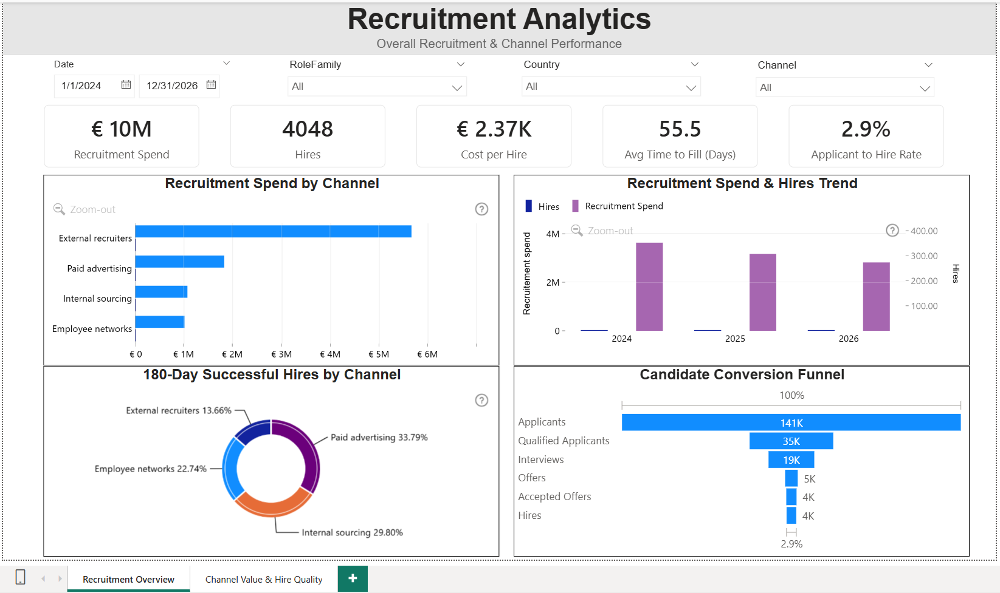
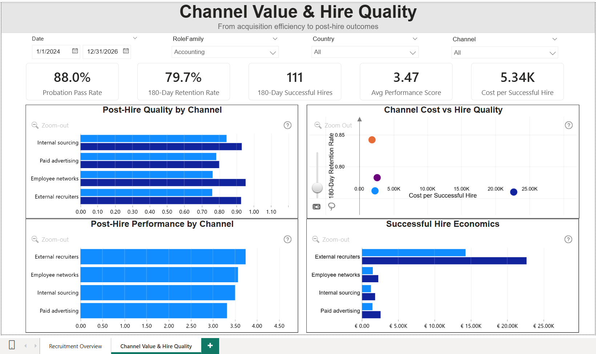

# Recruitment Channel Value Analytics Dashboard

## Overview

This Power BI project analyzes recruitment channel effectiveness across the complete hiring lifecycle, from candidate acquisition and funnel conversion through probation, retention, post-hire performance, and successful-hire economics.

The analysis goes beyond traditional recruitment metrics such as hiring volume and Cost per Hire to answer a more strategic question:

> **Which recruitment channels deliver sustainable, high-quality hires at a reasonable acquisition cost?**

The dashboard was developed for the **ZoomCharts 4U Recruitment Analytics Challenge** and uses interactive ZoomCharts Drill Down visuals to enable deeper exploration of recruitment performance.

---

## Business Objective

Recruitment channels can appear effective when evaluated only on initial hiring outcomes.

A channel may:

- Generate a high number of hires
- Have a reasonable Cost per Hire
- Deliver candidates quickly

However, those metrics alone do not show whether those hires:

- Pass probation
- Remain with the organization
- Perform effectively
- Become successful longer-term hires

This dashboard connects **recruitment acquisition metrics with post-hire outcomes** to provide a more complete view of recruitment channel value.

---

## Dashboard Preview

### Page 1: Recruitment Analytics

The Recruitment Analytics page provides an executive view of recruitment acquisition, cost efficiency, channel performance, hiring trends, and candidate conversion.



#### Key areas covered

- Recruitment Spend
- Total Hires
- Cost per Hire
- Average Time to Fill
- Applicant-to-Hire Rate
- Recruitment Spend by Channel
- Recruitment Spend & Hires Trend
- 180-Day Successful Hires by Channel
- Candidate Conversion Funnel

The candidate journey is analyzed across:

```text
Applicants
    ↓
Qualified Applicants
    ↓
Interviews
    ↓
Offers
    ↓
Accepted Offers
    ↓
Hires
```

---

### Page 2: Channel Value & Hire Quality

The Channel Value & Hire Quality page extends the analysis beyond hiring volume to evaluate post-hire outcomes and quality-adjusted recruitment economics.



#### Key areas covered

- Probation Pass Rate
- 180-Day Retention Rate
- 180-Day Successful Hires
- Average Performance Score
- Cost per Successful Hire
- Post-Hire Quality by Channel
- Channel Cost vs Hire Quality
- Post-Hire Performance by Channel
- Successful Hire Economics

This page helps evaluate whether recruitment channels continue to generate value **after the initial hire**.

---

## Analytical Framework

The dashboard follows the recruitment lifecycle beyond candidate acquisition:

```text
Applicants
    ↓
Qualified Candidates
    ↓
Interviews
    ↓
Offers
    ↓
Accepted Offers
    ↓
Hires
    ↓
Probation
    ↓
180-Day Retention
    ↓
Successful Hire
    ↓
Post-Hire Performance
```

Recruitment channels are evaluated across three dimensions:

### 1. Acquisition Efficiency

How efficiently does recruitment investment translate into hires?

### 2. Hire Quality

Do employees sourced through each channel pass probation, remain retained, and perform effectively?

### 3. Sustainable Recruitment Value

What does it actually cost to generate a successful hire rather than simply complete a hire?

---

## Business Questions Addressed

The dashboard is designed to answer:

1. Which recruitment channels receive the highest investment?
2. Which channels generate the greatest hiring volume?
3. How efficiently does recruitment spend translate into hires?
4. Where does candidate conversion drop within the recruitment funnel?
5. Which channels produce stronger probation outcomes?
6. Which channels deliver stronger 180-day retention?
7. How does post-hire performance vary by recruitment source?
8. Which channels generate the most successful hires?
9. Which channels have the lowest Cost per Successful Hire?
10. Does a low Cost per Hire still represent good value after retention and post-hire outcomes are considered?

---

## Key Measures

| Metric | Purpose |
|---|---|
| Applicants | Total candidate volume |
| Qualified Candidates | Candidates meeting qualification criteria |
| Interviews | Candidates progressing to interview |
| Offers | Offers issued |
| Accepted Offers | Offers accepted |
| Hires | Completed hires |
| Recruitment Spend | Total recruitment investment |
| Cost per Hire | Recruitment cost per completed hire |
| Average Time to Fill | Recruitment speed |
| Applicant-to-Hire Rate | Overall funnel conversion |
| Probation Pass Rate | Early post-hire success |
| 180-Day Retention Rate | Medium-term employee retention |
| 180-Day Successful Hires | Sustainable hiring outcome |
| Average Performance Score | Post-hire performance indicator |
| Cost per Successful Hire | Quality-adjusted recruitment acquisition cost |

---

## Interactive Analysis

The report supports interactive filtering by:

- **Date**
- **Role Family**
- **Country**
- **Recruitment Channel**

ZoomCharts visuals provide drill-down exploration through:

```text
Channel Group
    ↓
Channel
    ↓
Provider
```

Time-based analysis supports:

```text
Year
  ↓
Quarter
  ↓
Month
```

Cross-filtering allows users to investigate specific recruitment segments while maintaining the broader acquisition and post-hire context.

---

## Why Cost per Successful Hire Matters

Traditional recruitment reporting commonly evaluates:

```text
Recruitment Spend
        ÷
      Hires
        =
   Cost per Hire
```

This project extends the analysis to:

```text
Recruitment Spend
        ÷
180-Day Successful Hires
        =
Cost per Successful Hire
```

A recruitment source that appears cost-effective based only on initial hires may look very different after probation, retention, and successful-hire outcomes are considered.

**Cost per Successful Hire therefore provides a quality-adjusted perspective on recruitment economics.**

---

## Power BI Measures

### Recruitment Funnel

```text
Applicants
Qualified Candidates
Interviews
Offers
Accepted Offers
Hires
```

### Funnel Conversion

```text
Qualification Rate
Interview Rate
Offer Rate
Offer Acceptance Rate
Hire Conversion Rate
Applicant-to-Hire Rate
```

### Recruitment Efficiency

```text
Recruitment Spend
Cost per Hire
Average Time to Fill
```

### Post-Hire Quality

```text
90-Day Eligible Hires
Passed Probation Hires
Probation Pass Rate

180-Day Eligible Hires
180-Day Retained Hires
180-Day Retention Rate
180-Day Successful Hires

Performance Rated Hires
Average Performance Score
Cost per Successful Hire
```

---

## Tools & Technologies

- Microsoft Power BI Desktop
- DAX
- Power BI Data Modeling
- ZoomCharts Drill Down Visuals
- Interactive Slicers
- Drill-down Hierarchies
- Cross-filtering
- Recruitment Funnel Analysis
- Cost & Efficiency Analysis
- Post-Hire Quality Analytics
- Python for supporting data preparation/generation

---

## Repository Structure

```text
Recruitment_Dashboard/
│
├── README.md
├── Recruitment Dashboard_ZoomCharts.pbix
├── Page0.png
├── Page1.png
├── Data distribution.xlsx
└── DataGen.py
```

### Repository Files

| File | Description |
|---|---|
| `Recruitment Dashboard_ZoomCharts.pbix` | Final interactive Power BI dashboard |
| `Page0.png` | Recruitment Analytics dashboard preview |
| `Page1.png` | Channel Value & Hire Quality dashboard preview |
| `Data distribution.xlsx` | Supporting data distribution file |
| `DataGen.py` | Supporting Python data-generation/preparation script |
| `README.md` | Project documentation |

---

## Project Highlights

- End-to-end recruitment lifecycle analysis
- Candidate conversion funnel
- Recruitment channel cost analysis
- Recruitment Spend vs Hiring Outcomes
- Cost per Hire analysis
- Probation outcome analysis
- 180-day retention analysis
- 180-day successful-hire analysis
- Post-hire performance analysis
- Cost per Successful Hire analysis
- Interactive ZoomCharts drill-down functionality
- Channel Group → Channel → Provider exploration
- Year → Quarter → Month trend exploration
- Interactive filtering across Date, Role Family, Country, and Channel
- Two-page executive-focused Power BI design

---

## Key Takeaway

Recruitment channel effectiveness should not be evaluated only by **how many people are hired** or **how cheaply those hires are acquired**.

A more complete assessment considers what happens after hiring.

By connecting recruitment acquisition cost with probation, retention, successful-hire outcomes, and post-hire performance, this dashboard provides a framework for answering:

> **Which recruitment channels generate sustainable hiring value, not just hiring volume?**

---

## Challenge

This project was created as a submission for the **ZoomCharts 4U Recruitment Analytics Power BI Challenge**.

The report uses multiple interactive ZoomCharts Drill Down visuals while maintaining a concise two-page analytical experience focused on both **recruitment efficiency** and **long-term hire quality**.

---

## Author

**Saumya Sangamkar**

Power BI | Data Analytics | AI & Automation

[Connect with me on LinkedIn](https://www.linkedin.com/in/saumya-bartaria-3003/)
